# Rustify 🎵🦀

**Rustify** is an Android music player that uses your Spotify library as the catalogue and a backend
of your own choosing for the audio, over a native **Rust core** wired in through JNI.

It is a personal project, released as betas. Local music, YouTube Music and search work without any
account; your own Spotify session brings in your library and Home, plus whatever the audio backend
you pick asks for. It keeps everything it knows about you on your own device.

> **Current:** app `4.8.0b` · core `4.8.0` · `minSdk 29` · `targetSdk 36`
>
> The Rust core is built from the same commit as the app and carries the same version number.

---

## 📸 Screenshots

Taken signed out — everything shown works without a Spotify account. The first fourteen are from the
Android emulator; the last five from a POCO F8 Ultra (Snapdragon 8 Elite Gen 5), since the audio
lab's SME kernels and Gemini Nano need the real hardware.

|   |   |   |   |
|---|---|---|---|
| 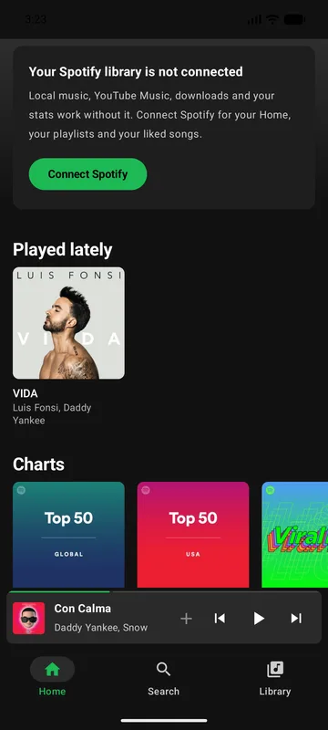 | 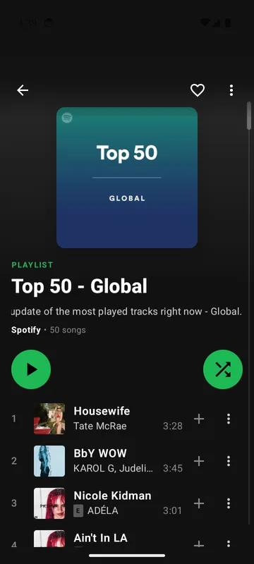 | 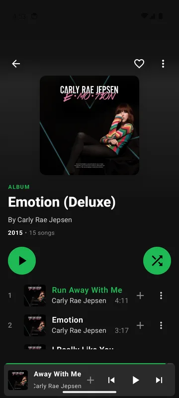 |  |
| Home without an account | Playlist | Album | Now playing |
| 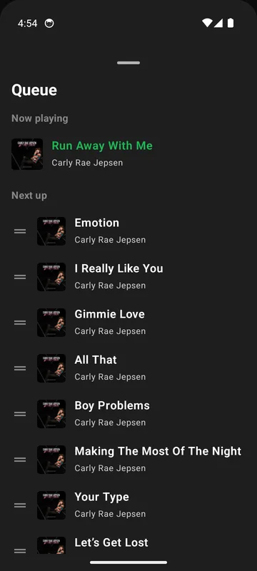 | 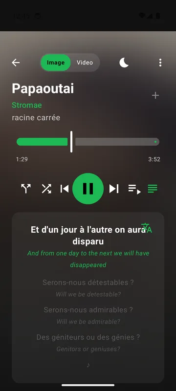 | 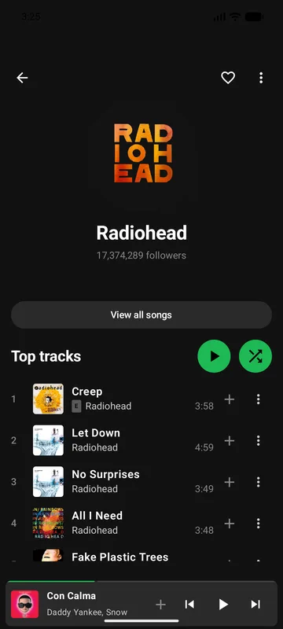 | 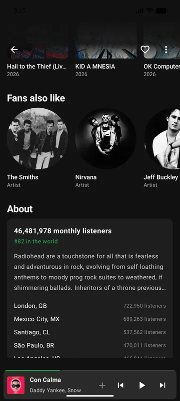 |
| Queue — drag to reorder | Lyrics, translated on the phone | Artist | Artist · About |
| 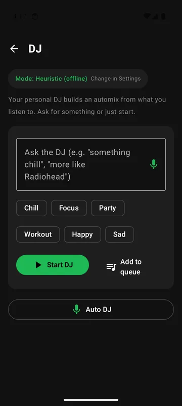 | 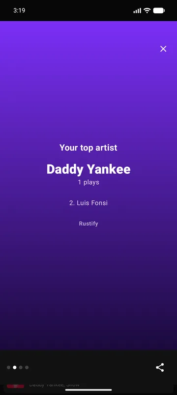 |  | 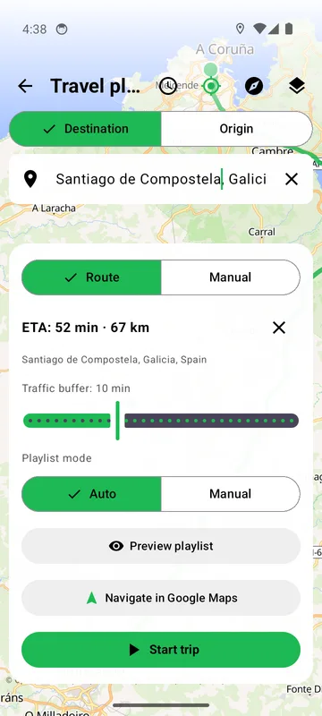 |
| DJ — moods in one tap | Your year in music | Travel playlist | Route → playlist length |
| 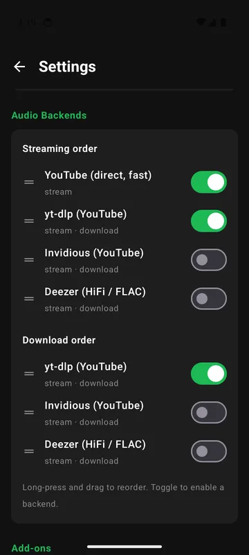 | 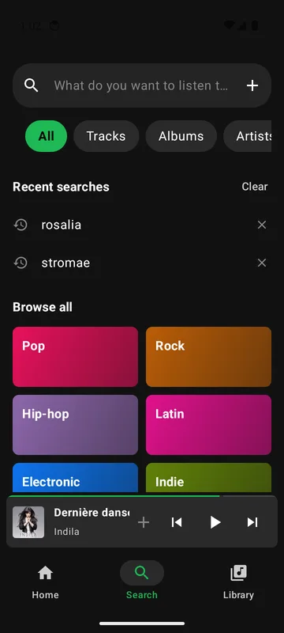 | 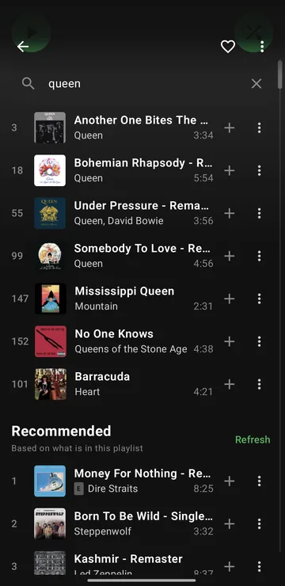 | 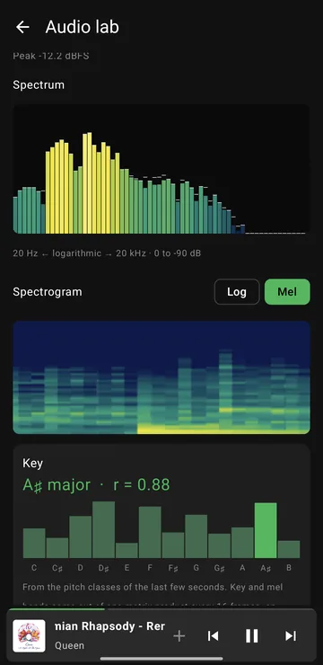 |
| Audio sources, fastest first | Search — recent and browse | Find in a playlist | Audio lab — spectrum, mel and key |
| 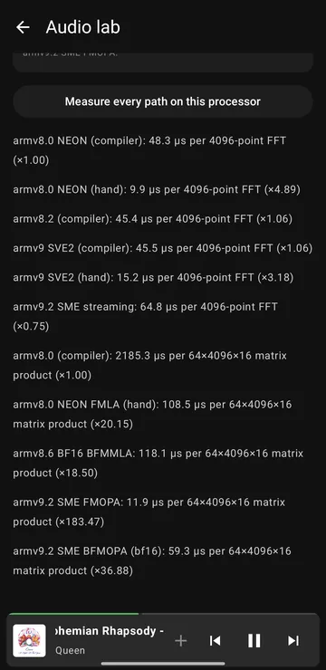 | 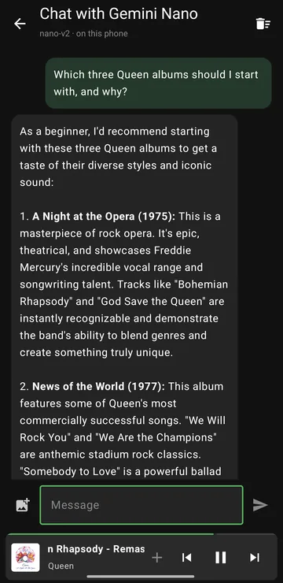 | 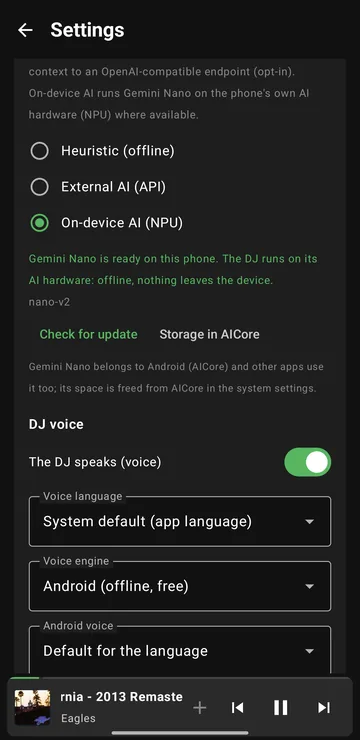 |
| Every ARM path, measured (SME 9× NEON) | Chat with Gemini Nano, on the phone | Gemini Nano for the DJ |

---

## ✨ Key Features

### 🎧 Playback & Audio
- **Spotify to audio** — Your liked tracks, playlists and albums come from Spotify; the Rust resolver
  matches each one against a source using ISRC lookups, folded-title comparison and a duration check,
  with a fallback chain behind it. YouTube audio is resolved by the core itself with one request — seconds
  instead of the half minute yt-dlp took — with yt-dlp kept as the fallback and for downloads.
- **Backends you can install** — Settings → Audio → **Add-ons**: paste a URL and it joins the same
  list as yt-dlp, Invidious and Deezer, reorderable and switchable, taking part in the same fallback
  chain. An add-on is told the title, the artists, the duration and the identifiers of a track and
  nothing else — never your session, never your library, never anything about your device — and there
  is a test that checks that rather than a comment promising it.
- **Pluggable backend chain** — Per-source priority, enable/disable switches and per-provider
  timeouts, shared by playback and downloads, each with its own diagnostics and playback test. Sources
  **race**: the next starts if the first has not answered in 4 s, and the first answer plays. The
  default order follows speed and robustness — the direct YouTube client, then yt-dlp (slower, but it
  updates itself), then add-ons; Invidious and Deezer last and off.
- **Sound** — Volume normalised from song to song with YouTube's loudness data, a fade between songs,
  an equaliser and a sleep timer that fades out and pauses.
- **Battery** — On phones that support it, the audio chip (DSP) decodes the song and the processor
  sleeps between buffers of several minutes, instead of waking every few milliseconds. It steps aside
  by itself while the equaliser, the fade, the video or the audio lab need the processor.
- **Stored songs** — A song you have played once is kept on the device (512 MB, oldest evicted first)
  and served to the player as an ordinary address on `127.0.0.1`, so it starts instantly and seeks
  properly. The first play is unchanged: nothing waits for a download. Local files are never copied.
  One switch in Settings → Audio turns the whole mechanism off.
- **Deezer without a special case** — Deezer tracks arrive Blowfish-encrypted in 2048-byte stripes
  and are decrypted **as they arrive**, by the same local server, so what reaches the player is a
  plain URL with working range requests. Nothing is downloaded before the music starts.
- **YouTube Music** — Search, albums, artists, playlists and a local YTM library (favourites, saved
  albums/artists, custom playlists). Switch between the YTM API and the general YouTube scraper for
  covers and unofficial content.
- **Local music** — Scan your own folders and play local files, optionally preferring a local copy
  over a streamed one. The match runs in the core, over the same accent folding the library search
  uses, so a file tagged `Bjork - Joga` still matches *Björk – Jóga*.
- **Media3 player** — ExoPlayer with a configurable disk cache and a foreground service, auto-retry
  with exponential backoff, and automatic re-resolution when a stream URL expires.
- **Background downloads** — Tracks, albums and playlists for offline playback, plus a screen for
  downloading arbitrary sources.
- **Audio alternatives** — Pick a different source for any track. Manual choices persist, take
  priority over auto-matching, and have their own editor with search and filtering.
- **Play on another device** — Send what is playing to a speaker, TV or receiver on your wifi (DLNA).
  The queue stays on the phone; play, pause and seek go to the device, and the progress bar comes
  back from it. Off until you turn it on — see [§3](#3-casting-and-the-one-open-door) for why that
  matters.
- **Spotify web player** — Spotify's own web player inside the app, with network filtering driven by
  uBlock Origin's public filter lists. Experimentally, it can also act as the playback backend,
  driven by Rustify's own transport controls.

### 🚗 In the Car
- **Android Auto** — Browse your library, search (no account needed), recently played, shuffle and
  repeat from the head unit, over a media tree that stays in sync with the app; albums and
  playlists show as a grid of covers.
- **Travel Playlist** — Compute a route and fill a playlist to match its estimated duration, on an
  open-source, keyless map stack.

### 📚 Library, Discovery & Metrics
- **Search that ignores accents and word order** — `bjork` finds Björk; `dark side moon` finds *The
  Dark Side of the Moon*. Results are ranked rather than merely filtered, and songs can be found by
  their album. One implementation, in the core, for every tab. Before you type, Search shows your
  recent searches and categories to browse (genres and moods, Spotify's own playlists first).
- **Find in a playlist** — A search box on every playlist, over the whole of it and not just what has
  loaded; playing a result plays the playlist from there.
- **Pick up where you left off** — A row on Home for the albums, playlists and radios you were partway
  through, showing `4/12 · Song Name` and resuming at the track and the minute you left. It keeps
  several at once; a song you skipped past does not qualify, and something you finished disappears.
- **What you have already heard** — Albums and playlists mark fully-listened tracks with a tick where
  the track number goes. It survives a playlist being edited.
- **AI DJ** — Automixes from your listening history in three modes: heuristic (offline,
  rule-based), an external OpenAI-compatible API, and **on-device** — Gemini Nano through Android's
  AICore, on the phone's NPU where it has one: offline, no key, nothing leaves the phone. One-tap
  moods (chill, focus, party, workout, happy, sad) and "more like" your most played artists.
  Settings shows the model's download, size and updates, and there is a **chat with Gemini Nano**
  (with photos) that never leaves the phone.
- **Listening metrics** — Every play kept, with no ceiling, in the core. Plays, time, streaks and
  per-artist records (bronze to platinum) by track, artist and album, against the previous period,
  with a full history. Imports Spotify's Extended and legacy `StreamingHistory*.json` exports, with
  deduplication.
- **Your year in music** — A Wrapped-style recap of any year from the history on your phone —
  minutes, top artist and song, what kind of listener you are — as cards you can share as an image.
- **Song Radio** — Spotify's own radio for any track, without an account.
- **Credits & recommendations** — Who wrote, played and produced a song; ten songs that fit any
  playlist, under it. Both from the public catalogue, no account needed.
- **Artist pages** — Top tracks, discography, fans also like, and *About*: monthly listeners, world
  rank, biography, the cities that listen most and upcoming concerts.
- **New Releases & full discographies** — Latest releases grouped by when they actually came out
  (Spotify gives dates at three precisions, and treating them alike puts a whole year on 1 January),
  plus a per-artist view of every track in release order.

### 💾 Data & Sync
- **Your data, in a file you own** — Export everything Rustify keeps (chosen matches, what you were
  in the middle of, what you have listened to, installed add-ons) as one readable JSON file, and
  restore it here or on another phone. **It never contains a password or a session** — there is a
  list of what is deliberately left out, and a test that checks the file does not carry it.
- **Google Drive backup/sync** — Bidirectional sync of matches, local playlists/favourites, the YTM
  library and metrics through the private `appDataFolder`. Merge is set-union + last-write-wins +
  metrics dedupe.
- **Local playlists** — Create, rename and manage playlists of local and YTM tracks, with mosaic
  covers from the first tracks.
- **State persistence** — Versioned schema with migrations, atomic temp-and-rename writes, debounced
  serialization. Playback position, queue, repeat, shuffle **and where the queue came from** all
  survive a restart.

### 🔗 Deep Linking & Sharing
- **One link parser** — Spotify tracks, albums, playlists and artists (including `/intl-XX/` routes),
  YouTube Music links, and clipboard paste, all read by the same code in the core. A song shared from
  inside a playlist opens the song.
- **Rustify wrapper links** — Share links on your own verified domain (`https://<host>/r/?s=<url>`)
  that open directly in Rustify via Android App Links, with a `rustify://` fallback. They are
  unwrapped by the same code that wraps them, older forms included.
- **Dual share** — "Share" sends the plain link; "Share as Rustify Link" appears as a second button
  when the toggle is on, and attaches the cover art.

### 🔄 Updates
- **In-app updater** — Checks GitHub Releases on demand or at startup, shows the changelog for every
  version you missed, downloads the build matching your device, and lets you pick the installer.

### 🎨 Interface & UX
- **Jetpack Compose + Material 3** — Reactive state via `StateFlow`, navigation over a manual stack
  with `SaveableStateHolder`. Synchronized auto-scrolling lyrics (Spotify's own when signed in,
  then LRCLIB and others, reorderable) with **on-device translation** line by line (ML Kit, offline
  once the model is downloaded),
  library management with bulk actions, pull-to-refresh, draggable queue reordering, swipe-to-queue
  and adaptive marquee scrolling.
- **Spotify Canvas** — Short looping muted videos behind the cover art and controls; tap to hide the
  UI and watch full-screen. The protobuf is decoded by hand in Rust, with no extra dependency.

### 🪵 Developer & Diagnostics
- **Audio lab** — Settings → Advanced: waveform, spectrum, spectrogram (log or mel) and the **key**
  of what is playing. The FFT and the matrix product behind them have hand-written kernels for each
  ARM generation — NEON, SVE2, BF16 and **SME**, the matrix unit of armv9.2 — chosen at runtime by
  what the processor reports and by which one is measured fastest on it. The lab shows them and times
  each: on a Snapdragon 8 Elite Gen 5, SME computes the key's matrix product 9× faster than NEON.
- **In-app log capture** — Real-time `logcat` with colour-coded levels, tag/level filtering,
  autoscroll and export. Persisted to `filesDir`, so it survives a crash.
- **Tests** — 310 in the Rust engine (301 unit, 9 end-to-end; clippy-clean and enforced in CI) and 104
  in Kotlin, run by
  `scripts/test.ps1` and measured by `scripts/coverage.ps1`.
- **Baseline profiles** — Faster startup via Jetpack ProfileInstaller.
- **Internationalization** — English, Spanish and Japanese.

---

## 🏗️ Architecture & Tech Stack

Rustify is a Kotlin app over a Rust engine, and the split is deliberate: everything that is a
*decision* — what a link means, which audio matches which track, what "previous" does, whether a
failure is worth retrying — lives in the core, in one place, testable without a phone. Kotlin keeps
what is genuinely Android.

The 3.x series exists to make that true. The engine no longer assumes it is running on Android, which
is what a Windows or iOS port would need, and it is the reason the engine went from four tests to
257.

### 1. The Core Engine (Rust 🦀)

`core_engine/`, compiled to `libcore_engine.so`:

| Module | What lives there |
| --- | --- |
| `env/` | The platform boundary: HTTP, storage, clock, background work, logging. `android.rs` is the only place `reqwest` appears; `mock.rs` is what makes the engine testable with no network; `schema.rs` versions everything persisted. |
| `spotify/` | The web client — GraphQL query hashes kept current, `sp_dc` session, token refresh, `Retry-After` — plus album, artist, playlist, track, search, browse, user, and the hand-rolled Canvas protobuf. |
| `youtube/` | RustyPipe 0.11 for YouTube Music, and a general YouTube scraper for the "find alternatives" dialog and the Explore tab. |
| `audio/` | Deezer's Blowfish/CBC stripe scheme. |
| `server/` | The local streaming server: disk cache, range requests, handles, the decrypt-in-transit proxy, and `lan.rs` — the single place that binds a real network interface. |
| `addon/` | The add-on protocol and its host security: resolve the name, judge every address it resolves to, pin the connection to what was approved. |
| `matcher/` | `algorithm.rs` matches a Spotify track to an audio source; `local.rs` matches it to a file on your phone. |
| `search/` | Accent-folding index and query, shared by every list in the app. |
| `player/` | The queue reducer: next, previous, repeat, end of queue. |
| `links/` | Every link shape Rustify reads or writes. |
| `listened/` | "Already heard" as a bitfield that survives a playlist being edited. |
| `calendar/` | Release dates at the three precisions Spotify actually returns. |
| `export/` | The user-owned data export, and the deny-list of what must never be in it. |
| `types/id.rs` | `TrackId` / `PlaylistId` — content identity as a type rather than a string. |
| `errors.rs` | What kind of failure it was: `auth`, `rateLimited`, `transient`, `permanent`. |
| `adblock_engine.rs` | Brave's adblock-rust, parsing EasyList / uBO syntax for the in-app web player. |
| `lib.rs` | The JNI bridge — every Rust capability exposed to Kotlin over a JSON contract. |

Five things the core is built on, each of them the answer to a bug that shipped:

- **Content identity is a type.** A track id is never inspected with `startsWith` or split on `:`.
  Two shipped crashes came from doing that by hand, and both are now unrepresentable. The Kotlin and
  Rust codecs are pinned by tests covering the same cases on each side.
- **Nothing touches the platform directly.** No `reqwest`, no filesystem, no clock outside `Env`.
  That is what a second platform would implement, and what `MockEnv` replaces in tests.
- **A JNI call blocks the thread that makes it.** So the rule lives in the API: anything that can
  touch the network or the disk is `suspend` over `Dispatchers.IO`, and the blocking `external fun`
  underneath it is private. No lock is ever held across an `.await` — that was a real ANR.
- **Failure kind travels as a field, not as prose.** The engine knows whether a failure was auth,
  rate limiting, transport, or final; flattening that into a sentence and recovering it with a regex
  is one rewording away from silently breaking every retry.
- **Persisted state is versioned.** New shape, new migration step — never a stored shape changed in
  place.

### 2. The Android Client (Kotlin ☕)

`app/`, handling the experience and the OS integration:

- **UI layer** — Jetpack Compose and Material 3 throughout, unidirectional state over `StateFlow`.
- **Playback service** — `AudioPlayerService` owns the `ExoPlayer` instance, the URL cache and its
  expiry, the retry logic, and the cast session when there is one.
- **Media session** — `RustifyForegroundService`, a Media3 `MediaLibraryService` bound to the lock
  screen and Bluetooth controls, exposing the browsable tree Android Auto reads.
- **Audio chain** — `AudioSourceChain`, the provider chain with configurable order and per-provider
  timeouts, shared by playback and downloads.
- **Bridge layer** — `bridge/` is the Kotlin half of every core contract: `TrackRef`, `LocalMatcher`,
  `PlayerQueue`, `SpotifyRepository` and the rest.
- **Google Drive sync** — Browser-based OAuth (PKCE, AppAuth) with the `drive.appdata` scope, over
  OkHttp and REST v3.

### 3. Casting, and the one open door

Casting is the only feature that binds anything to a real network interface, and four independent
things hold it together: nothing is open until a cast session starts; the bind is to **one interface
address**, never `0.0.0.0` (the core refuses that, and refuses loopback too); every accepted
connection's peer address is checked against the one device being cast to, before a byte is read; and
it closes on stop, on failure, and when the switch goes off.

Two honest limits: the phone is the source, so if it sleeps or leaves the wifi the music stops — this
is not Spotify Connect — and networks that isolate clients from one another (hotels, cafés) make it
impossible.

### 4. What deliberately stays in Kotlin

Not everything belongs in the core, and the line is drawn on purpose. Shuffle stays in Kotlin because
the ordering is Rustify's own — a hand-queued block keeps its place behind the current track — and
the reducer refuses to hold a random source at all. Local music is deliberately **not** routed
through the local server: it already plays, and HTTP would add a hop, a port and a token to something
with no problem.

---

## 🛠️ Building the Project

### Prerequisites
- **Android Studio** (Koala or newer recommended).
- **Android NDK** — required to compile the JNI bindings.
- **Rust toolchain** via `rustup`:
  ```bash
  rustup target add aarch64-linux-android armv7-linux-androideabi x86_64-linux-android
  ```
- **cargo-ndk**:
  ```bash
  cargo install cargo-ndk
  ```

### Compilation
`build.gradle.kts` invokes `cargo-ndk` to compile the Rust core before packaging the APK.

```bash
./gradlew assembleDebug     # debug
./gradlew assembleRelease   # release
```

### Tests

```powershell
pwsh scripts/test.ps1              # both suites
pwsh scripts/test.ps1 -Rust        # engine only
pwsh scripts/test.ps1 -Kotlin      # app only
pwsh scripts/coverage.ps1          # engine coverage
```

Worth knowing: `assembleRelease` does not build the test sources, and the Gradle build never invokes
`cargo test`. Run the script.

### Sideloading with AOT optimization
The release APK embeds its baseline profiles (`assets/dexopt/baseline.prof`) for background
optimization. To force immediate AOT compilation, install the APK alongside its Dex Metadata (`.dm`):

```bash
# ARM64 devices
adb install-multiple app/build/outputs/apk/release/app-arm64-v8a-release.apk app/build/outputs/apk/release/baselineProfiles/0/app-arm64-v8a-release.dm

# 32-bit ARM devices
adb install-multiple app/build/outputs/apk/release/app-armeabi-v7a-release.apk app/build/outputs/apk/release/baselineProfiles/0/app-armeabi-v7a-release.dm

# x86_64 emulators
adb install-multiple app/build/outputs/apk/release/app-x86_64-release.apk app/build/outputs/apk/release/baselineProfiles/0/app-x86_64-release.dm
```

> `baselineProfiles/0/` holds the profile for API 31 and above, `1/` the one for API 28-30. These come
> out of Gradle's output directory: Android Studio's signed-APK wizard writes to `app/release/` instead
> and does not copy the `.dm` files there.

---

## 🤝 Contributing

Contributions are welcome — open an Issue or a Pull Request. Two things worth knowing before you
start:

- Changes to the Rust core must compile for `aarch64`, `armv7` and `x86_64`, and both suites should pass
  (`pwsh scripts/test.ps1`).
- Several contracts are deliberately stated in two languages — track ids, error kinds, the Deezer
  stripe scheme — and each is pinned by tests covering the same cases on both sides. If you change
  one half, change the test on the other.

---

## 🌟 Acknowledgements

- The app icon uses the logo of the
  [Lightkeepers](https://genshin-impact.fandom.com/wiki/Lightkeepers) from Genshin Impact.

---

## ⚖️ License

Copyright (C) 2026 Pablo Soage Rodas

This program is free software: you can redistribute it and/or modify it under the terms of the **GNU
General Public License v3.0** as published by the Free Software Foundation.

This program is distributed in the hope that it will be useful, but WITHOUT ANY WARRANTY; without
even the implied warranty of MERCHANTABILITY or FITNESS FOR A PARTICULAR PURPOSE. See the `LICENSE`
file for more details.

You should have received a copy of the GNU General Public License along with this program. If not,
see https://www.gnu.org/licenses/.
